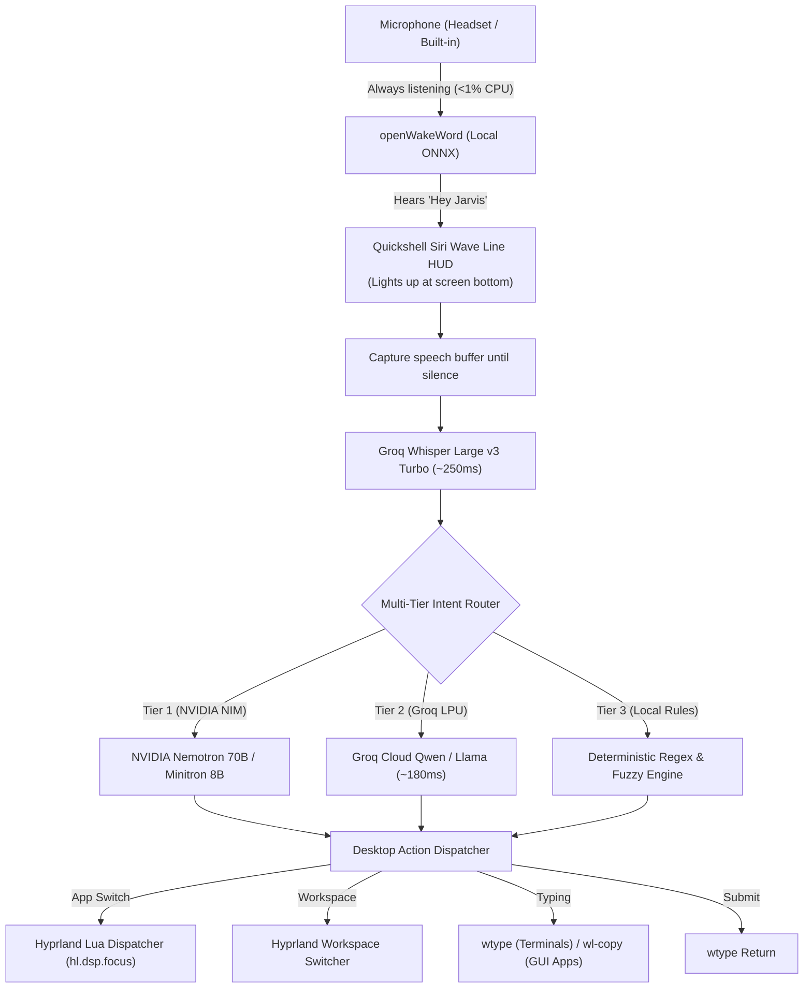

# InfinaFlow 🌊

> **Hands-free voice assistant for Omarchy Linux (Hyprland + Quickshell).**  
> An open-source alternative to [Infina](https://www.infina.so) designed specifically for developers, prompt engineers, and vibe-coders.

Type, submit prompts, switch apps, control workspaces, and drive your desktop by voice — **with zero keys to hold.**

---

## 🌟 The Problem InfinaFlow Solves

Every traditional voice-typing tool on Linux forces a manual keyboard friction loop:
* **Push-to-talk friction:** You have to hold down a physical key (`Super + S`, `Fn`, or mouse button) every single time you want to speak.
* **Manual app switching:** After dictating, you still have to touch your mouse or keyboard to switch windows, hit `Enter` to submit the prompt, or focus input boxes.
* **Prompt fatigue:** Developers interacting constantly with AI coding agents (Claude Code, Cursor, OpenCode, ChatGPT, Terminal) remain physically tethered to the keyboard.

**InfinaFlow solves this with a 100% hands-free voice loop:**
Say **"Hey Jarvis"**, dictate your prompt, say **"send it"**, and switch between your editor, browser, and terminal without ever touching your keyboard.

---

## 🏗️ Architecture



---

## ✨ Features

- 🎙️ **Zero-Button Always-Listening Wake Engine:** Powered by local `openWakeWord` running on-device (<15MB RAM, negligible CPU). Mic audio stays local until awakened.
- ⚡ **Sub-Second Speech-to-Text:** Groq Whisper Large v3 Turbo transcribes full technical vocabulary and punctuation in ~250ms.
- 🧠 **Dual-Tier LLM Intent Router with Local Fallback:**
  - **Tier 1:** NVIDIA NIM (`nvidia/llama-3.1-nemotron-70b-instruct` / `nvidia/mistral-nemo-minitron-8b-8k-instruct`)
  - **Tier 2:** Groq LPU (`qwen/qwen3.8-27b` / `llama-3.3-70b-versatile`)
  - **Tier 3:** High-speed local regex & fuzzy matcher (runs offline if network drops).
- 🪟 **Smart Hyprland Window Switching:** Checks running Hyprland windows first (`hl.dsp.focus`). If an app is already open, it switches immediately. Only launches a new window if it isn't running.
- 🌊 **Siri Wave Line HUD:** Native Quickshell layer-shell overlay centered at the bottom of the screen with dynamic bezier wave physics, real-time volume reactivity, and click-through transparency.
- 🔢 **Spoken Number Resolution:** Full support for word numbers ("workspace one", "move to workstation two" → switches/moves to workspace 1 or 2).
- 💻 **Terminal-Aware Keystroke Injection:** In terminal emulators (`foot`, `kitty`, `alacritty`), characters are injected cleanly via `wtype` without clipboard conflicts.

---

## 🚀 Quick Start (Omarchy Linux)

### 1. Clone & Install
```bash
git clone https://github.com/jahangeer-dev7/infina-flow.git
cd infina-flow
./install.sh
```

### 2. Configure API Keys
Add your Groq API key (and optional NVIDIA NIM key) in `~/.config/infina-flow/infina.env` (or `~/.config/voxtype/voxtype.env`):
```bash
# Required for fast STT & Tier 2 LLM routing
GROQ_API_KEY="gsk_..."

# Optional: NVIDIA NIM Tier 1 LLM & Vision Grounding
NVIDIA_API_KEY="nvapi-..."
```

### 3. Restart & Verify
```bash
systemctl --user restart infina-flow.service
systemctl --user status infina-flow.service
```

---

## 🗣️ Voice Commands Catalog

### The Infina Model: "Open. Type. Send it."
Just speak after saying **"Hey Jarvis"**:

```
"Hey Jarvis"              → Activates assistant (Wave Line lights up)
"Open Chrome"             → Focuses your existing Chrome window
"Review this pull request send it" → Types text and presses Enter
"Open Terminal"           → Focuses foot terminal
"git status send it"      → Types 'git status' and runs it
"Clear it"                → Selects all and deletes active text
"Close"                   → Puts assistant back to sleep
```

### Comprehensive Command Table

| Category | Spoken Phrases | Action Executed |
| :--- | :--- | :--- |
| **App Switching** | `"Open Chrome"`, `"Open Terminal"`, `"Open Paseo"`, `"Open Calc"`, `"Open Cursor"`, `"Open Files"` | Focuses running instance or launches app |
| **Workspaces** | `"Workspace 1"`, `"Workspace two"`, `"Next workspace"`, `"Move to workspace 3"` | Hyprland Lua workspace dispatch |
| **Browser** | `"New tab"`, `"Create a tab"`, `"Close tab"`, `"Next tab"`, `"Go back"`, `"Refresh"`, `"Scroll down/up"` | Direct browser shortcuts |
| **Media & Audio** | `"Volume up"`, `"Volume down"`, `"Mute"`, `"Play"`, `"Pause"`, `"Next song"` | Omarchy OSD audio & media keys |
| **Editing** | `"Select all"`, `"Copy"`, `"Paste"`, `"Cut"`, `"Undo"`, `"Redo"`, `"Save"`, `"Delete word"` | Virtual keyboard key injection |
| **Window Mgmt** | `"Fullscreen"`, `"Minimize"`, `"Toggle float"`, `"Split left"`, `"Alt Tab"` | Hyprland window tiling controls |
| **System** | `"Lock screen"`, `"Sleep computer"`, `"Battery status"`, `"What time is it"`, `"Bluetooth on/off"` | Desktop environment controls |

---

## 🛠️ Service Management

InfinaFlow runs as a background user systemd daemon:

```bash
# Check status
systemctl --user status infina-flow.service

# Live logs
journalctl --user -u infina-flow.service -f

# Restart / Stop
systemctl --user restart infina-flow.service
systemctl --user stop infina-flow.service
```

---

## 📄 License

MIT License © 2026 [Jahangeer I](https://github.com/jahangeer-dev7).
